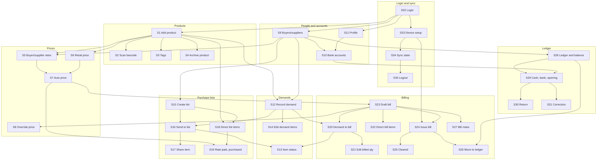

# Story dependencies

`A --> B`: story B cannot be built before story A. Direct dependencies only. Stories: `wholesale_project.md`.

## Build order

Stories on the same line can be built in parallel.

1. S32
2. S33, S1, S9, S11
3. S34, S2, S3, S4, S5, S6, S10, S12, S15, S28
4. S35, S7, S14, S16, S18, S29
5. S17, S19, S23, S30, S31
6. S8, S20, S22, S24, S27
7. S13, S21, S25, S26
